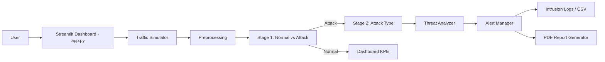
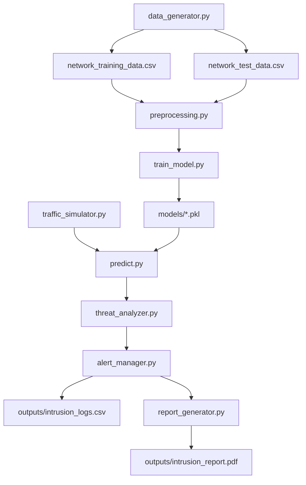
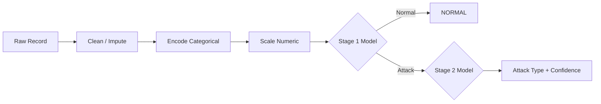
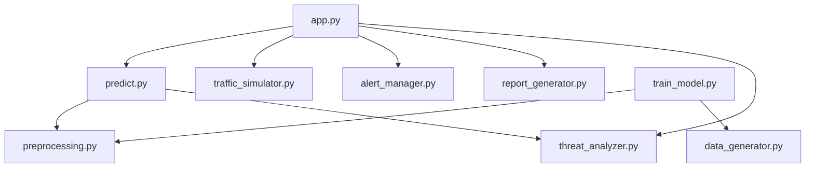
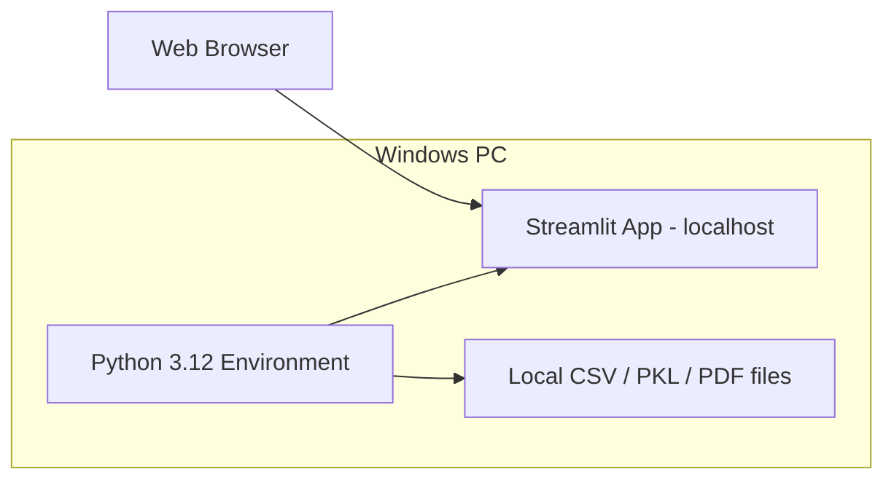

# AI-Driven Network Intrusion Detection and Threat Monitoring System

A **software-only, simulation-based** academic project that demonstrates how
machine learning can be applied to network intrusion detection — no
physical networking hardware, no real network traffic, no real attacks.

---

## 1. Abstract

This project implements an AI-driven Network Intrusion Detection System
(NIDS) that generates synthetic network traffic, trains machine learning
models to classify traffic as normal or malicious, assigns a threat
severity, and presents everything through an interactive Streamlit
dashboard with live simulation, visual analytics, alert logging, and
downloadable PDF reports.

## 2. Problem Statement

Traditional signature-based intrusion detection struggles against novel
or evolving attack patterns. This project explores a machine-learning
approach that learns statistical traffic signatures (packet rate, byte
rate, connection/failure counts, etc.) to classify traffic, entirely
within a safe, simulated, academic environment.

## 3. Objectives

- Generate realistic synthetic network traffic (normal + 5 attack types)
- Train and compare multiple ML algorithms
- Build a two-stage detection pipeline (Normal/Attack → Attack Type)
- Assign application-level threat severity
- Provide live simulated monitoring via a dashboard
- Log events, visualize statistics, and export PDF/CSV reports

## 4. Proposed System

A modular Python pipeline: data generation → preprocessing → training →
prediction → severity scoring → alerting → dashboard visualization →
reporting. See `config.py` for all tunable parameters.

## 5. System Architecture



### Data Flow Diagram



### ML Pipeline



### Module Interaction Diagram



### Deployment Diagram



## 6. Technologies

Python 3.12, pandas, numpy, scikit-learn, joblib, Streamlit, Plotly,
matplotlib, seaborn, fpdf2.

## 7. Dataset

10,000 synthetic records (configurable via `NUMBER_OF_RECORDS` in
`config.py`), 6 classes: Normal, DoS, DDoS, Port Scan, Brute Force,
Suspicious Traffic. Each attack type has a distinct statistical
signature (see `src/data_generator.py` docstrings) so the models learn
genuine patterns rather than memorizing labels.

## 8. ML Methodology

Two-stage pipeline:
- **Stage 1** (binary): Normal vs Attack
- **Stage 2** (multiclass, attack rows only): DoS / DDoS / Port Scan /
  Brute Force / Suspicious Traffic

Five algorithms are trained and compared per stage (Logistic Regression,
Decision Tree, Random Forest, Gradient Boosting, SVM); the best by
weighted F1-score is automatically selected and saved.

## 9. Attack Simulation

See Section 7 above and `src/data_generator.py`. Live simulation
(`src/traffic_simulator.py`) reuses the same generators, weighted by a
configurable attack probability, to produce a continuous stream —
clearly labeled **"Simulated Network Traffic"** throughout the UI.

## 10. System Modules

| File | Purpose |
|---|---|
| `config.py` | Central constants/paths |
| `src/data_generator.py` | Synthetic dataset generation |
| `src/preprocessing.py` | Shared clean/encode/scale pipeline |
| `src/train_model.py` | Trains, compares, and selects models |
| `src/predict.py` | Two-stage inference on a single record |
| `src/traffic_simulator.py` | Live simulated traffic stream |
| `src/threat_analyzer.py` | Severity scoring |
| `src/alert_manager.py` | Alert/log creation, filtering, CSV export |
| `src/report_generator.py` | PDF report generation |
| `src/utils.py` | Shared helpers |
| `app.py` | Streamlit dashboard |

## 11. Installation

```powershell
cd AI-Network-Intrusion-Detection
python -m venv venv
venv\Scripts\activate
pip install -r requirements.txt
```

## 12. How to Run

### Generate the dataset
```powershell
python src\data_generator.py
```
Expected output: `data/network_training_data.csv` and
`data/network_test_data.csv` created; console shows class distribution.

### Train the models
```powershell
python src\train_model.py
```
Expected output: model comparison metrics printed per stage; files
saved to `models/`: `intrusion_detection_model.pkl`,
`attack_classification_model.pkl`, `scaler.pkl`, `encoders.pkl`,
`metrics.json`.

### Start the dashboard
```powershell
streamlit run app.py
```
Opens at `http://localhost:8501`. Use the sidebar to navigate; start
with **Model Performance** to see trained metrics, then **Live Traffic
Simulation** to generate simulated traffic and watch detection happen
in real time.

### Run tests
```powershell
python -m pytest tests\ -v
```

## 13. Expected Output

A working local dashboard showing live simulated traffic classification,
attack-type breakdowns, severity-coded alerts, an intrusion log with
CSV export, model performance metrics with confusion matrices and
feature importance, and a downloadable PDF security report.

## 14. Limitations

- Traffic is synthetic, not captured from a real network.
- Severity levels are an application-level heuristic, not a
  standardized rating like CVSS.
- Explainability indicators are rule-based, not SHAP-based (SHAP can be
  added as a future enhancement).
- Not intended for, and not capable of, production network defense.

## 15. Future Enhancements

- Integrate a public NIDS dataset (e.g., CICIDS2017, NSL-KDD) alongside
  the synthetic generator.
- Add real SHAP-based explainability.
- Add a lightweight anomaly-detection (unsupervised) stage for
  zero-day-style traffic.
- Persist historical sessions to a local database instead of CSV.

## 16. Conclusion

This project demonstrates an end-to-end, reproducible pipeline for
AI-based network intrusion detection using only synthetic data and
standard Python ML tooling — suitable for a final-year academic
demonstration without any physical networking hardware.

---

## Demonstration Scenario

1. Open the dashboard (`streamlit run app.py`).
2. Go to **Model Performance** — show accuracy/precision/recall/F1 and
   confusion matrices (real numbers, computed at training time).
3. Go to **Live Traffic Simulation**, set attack probability, click
   **Start**.
4. Normal traffic rows appear in the live table, tagged NORMAL.
5. Attack traffic rows appear, tagged ATTACK with a type.
6. The AI classifies each record via the two-stage pipeline.
7. Attacks are added to the **Intrusion Logs** with a severity and a
   simulated action (MONITOR / ALERT / FLAG SOURCE / SIMULATED BLOCK).
8. Severity and attack type are shown live in **Threat Monitoring**.
9. Check **Attack Analysis** for distribution charts.
10. Go to **Reports**, click **Generate PDF Report**, and download it.

## Important Notes

- This application performs **no real network scanning, no real
  attacks, and no real blocking**. All "security actions" are labeled
  and treated as simulated only.
- No specialized hardware is required — a standard Windows PC is
  sufficient.
